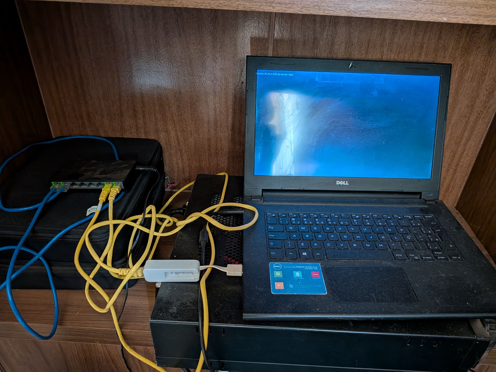

# Linux Homelab — Infraestrutura Self-Hosted

Homelab desenvolvido com hardware reaproveitado, visando aprendizado prático em administração de sistemas Linux, redes, armazenamento e automação, com baixo custo de implantação.

## Visão geral

O ambiente é composto por dois servidores físicos — um desktop e um notebook — conectados a um switch Gigabit Ethernet na rede doméstica principal.

A infraestrutura hospeda serviços de DNS, compartilhamento de arquivos, mídia e um servidor Minecraft de uso familiar.

O projeto prioriza a reutilização de equipamentos, a redução de custos operacionais e a experimentação com tecnologias de infraestrutura.

## Infraestrutura

### Servidor principal — Desktop

**Sistema operacional:** Ubuntu Desktop, com interface gráfica desativada via `systemctl`.

Hardware parcialmente reaproveitado, incluindo processador e módulos de memória recuperados de descarte eletrônico.

**Serviços:**

- **Samba:** compartilhamento de arquivos na rede local.
- **Jellyfin:** organização e reprodução do acervo digitalizado de CDs e DVDs.
- **Pi-hole:** filtragem de consultas DNS.
- **Unbound:** resolução DNS local.

**Armazenamento:**

- Disco independente para o sistema operacional.
- Dois HDDs de 4 TB em ZFS mirror.
- Pool ZFS denominado `hdd-4tb`.
- Verificação de integridade por scrub, com último resultado informado sem erros.

### Servidor secundário — Notebook

**Sistema operacional:** Ubuntu Server.

**Serviços nativos:**

- Pi-hole.
- Unbound.

**Serviços em Docker Compose:**

- Minecraft Fabric.
- lazymc, utilizado para iniciar o Minecraft sob demanda.

Os containers utilizam uma rede Docker bridge personalizada, volumes persistentes e configurações declarativas em YAML.

O servidor Minecraft é utilizado exclusivamente na rede doméstica.

## Arquitetura de rede

Os dois servidores estão conectados à rede principal através de um switch Gigabit Ethernet.

O roteador principal distribui os endereços dos dois servidores Pi-hole via DHCP.

Cada Pi-hole possui sua própria instância do Unbound, permitindo resolução DNS independente entre as duas máquinas.

A redundância DNS foi testada na rede principal.

### Sub-rede adicional

A infraestrutura doméstica também possui uma segunda sub-rede, conectada à rede principal por meio da interface WAN de outro roteador.

Esse roteador permite configurar apenas um servidor DNS via DHCP, limitando a redundância automática para seus clientes.

Essa limitação é conhecida e faz parte das características atuais do ambiente.

## Backups automatizados

O servidor Minecraft possui rotinas de sincronização remota executadas por `cron`, utilizando `rsync` sobre SSH.

Os arquivos são transferidos do notebook para o desktop, com destinos separados para cópias semanais e mensais.

O armazenamento de destino utiliza ZFS mirror.

As rotinas de sincronização não substituem um sistema completo de backups versionados, sendo essa uma possibilidade de melhoria futura.

## Tecnologias utilizadas

**Sistemas:** Ubuntu Server, Ubuntu Desktop, Linux CLI.

**Redes:** TCP/IP, DHCP, DNS, SSH, Ethernet e roteamento entre sub-redes.

**Serviços:** Pi-hole, Unbound, Samba, Jellyfin.

**Containers:** Docker, Docker Compose, redes bridge, bind mounts.

**Armazenamento:** ZFS mirror.

**Automação:** cron, rsync e SSH.

## Objetivos e aprendizados

- Administrar servidores Linux em equipamentos físicos.
- Implantar e manter serviços de rede.
- Experimentar redundância de DNS.
- Configurar armazenamento com tolerância à falha de disco.
- Administrar aplicações containerizadas.
- Automatizar tarefas de sincronização e backup.
- Diagnosticar problemas de infraestrutura.
- Reaproveitar hardware para reduzir custos.

## Melhorias futuras

- Documentar procedimentos de recuperação de serviços.
- Implementar e testar backups versionados.
- Adicionar monitoramento centralizado.
- Registrar testes de restauração.
- Expandir a documentação de rede e armazenamento.

## Documentação complementar

- `docs/network.md` — Topologia e DNS.
- `docs/storage.md` — Armazenamento ZFS.
- `docs/services.md` — Serviços hospedados.
- `docs/backups.md` — Automação e sincronização de dados.
