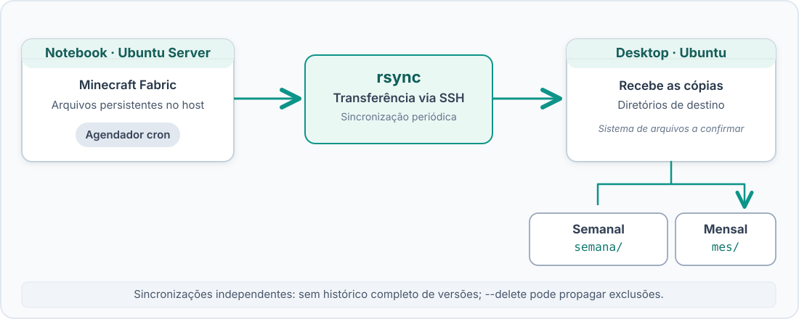

# Backups automatizados

## Visão geral

O homelab utiliza rotinas automatizadas de sincronização para manter cópias dos arquivos do servidor Minecraft em outro equipamento da rede doméstica. O processo utiliza `cron`, `rsync` e SSH, evitando a necessidade de iniciar as transferências manualmente.

O **notebook com Ubuntu Server** hospeda o Minecraft Fabric em Docker Compose e é a origem dos arquivos. O **desktop com Ubuntu** recebe as cópias em diretórios separados para as sincronizações semanais e mensais.




## Ferramentas utilizadas

- **[rsync](https://rsync.samba.org/):** sincroniza arquivos, transferindo alterações entre origem e destino.
- **[OpenSSH](https://www.openssh.com/):** fornece o transporte criptografado para a transferência entre os servidores.
- **cron:** executa as sincronizações automaticamente em horários programados.

## Implementação no homelab

As cópias são realizadas a partir do notebook, que envia o diretório do projeto Minecraft para o desktop. Existem dois destinos independentes:

| Rotina | Destino | Comportamento |
|---|---|---|
| Semanal | `semana/` | Sincronização periódica do conteúdo da origem |
| Mensal | `mes/` | Sincronização periódica do conteúdo da origem |

### Comando de sincronização

O comando abaixo reproduz a estrutura utilizada, com nomes de usuário, host e caminhos substituídos por **exemplos ilustrativos**:

```bash
# Cópia semanal
rsync -avz -e ssh --delete \
  /caminho/servidor-minecraft/ \
  usuario@desktop:/caminho/backups/semana/

# Cópia mensal
rsync -avz -e ssh --delete \
  /caminho/servidor-minecraft/ \
  usuario@desktop:/caminho/backups/mes/
```

As opções são utilizadas da seguinte maneira:

- **`-a`**: preserva a estrutura dos diretórios e metadados compatíveis com as permissões do destino.
- **`-v`**: exibe detalhes da transferência.
- **`-z`**: habilita compressão durante a transferência.
- **`-e ssh`**: utiliza SSH como transporte.
- **`--delete`**: remove arquivos do destino que não existem mais na origem.

A barra `/` ao final do caminho de origem indica que o conteúdo do diretório deve ser sincronizado para o destino.


### Agendamento com cron

Os comandos são executados automaticamente por meio de agendamentos no cron, com rotinas semanais e mensais.

O exemplo abaixo demonstra a estrutura utilizada, com horários, usuários e caminhos ilustrativos.

```cron
# Exemplo: toda segunda-feira às 03:00
0 3 * * 1 rsync -avz -e ssh --delete /caminho/servidor-minecraft/ usuario@desktop:/caminho/backups/semana/

# Primeiro dia de cada mês, à meia-noite
0 0 1 * * rsync -avz -e ssh --delete /caminho/servidor-minecraft/ usuario@desktop:/caminho/backups/mes/
```

## Limitações e riscos

### Sincronização não é versionamento

As pastas `semana/` e `mes/` armazenam cópias sincronizadas, não um histórico completo. A opção `--delete` replica exclusões da origem, e arquivos corrompidos ou modificados incorretamente podem sobrescrever cópias anteriores.

### Consistência do mundo Minecraft

O lazymc permite que o servidor Minecraft permaneça desligado quando não está sendo utilizado. Entretanto, um agendamento pode coincidir com gravações do mundo. A rotina atual não possui um procedimento documentado de coordenação com o salvamento do jogo.

### Recuperação

Uma sincronização concluída não garante que o mundo possa ser restaurado corretamente. Testes de restauração ainda são uma melhoria a implementar.

## Armazenamento dos backups

Os arquivos são transferidos do notebook para o desktop principal, onde ficam armazenados no pool ZFS `hdd-4tb`, configurado em mirror com dois HDDs de 4 TB.

O espelhamento oferece tolerância à falha de um dos discos, mas não protege contra exclusões acidentais ou corrupção lógica propagada pelas sincronizações.

Embora as cópias estejam armazenadas em outro equipamento, elas não possuem versionamento completo e permanecem sujeitas aos riscos associados ao servidor de destino.

## Possíveis melhorias

- **Consistência:** coordenar a sincronização com o salvamento do mundo Minecraft.
- **Versionamento:** manter cópias anteriores por meio de snapshots ou outra estratégia de retenção.
- **Alertas:** registrar resultados e notificar falhas nas transferências.
- **Restauração:** testar periodicamente a recuperação dos arquivos a partir das cópias existentes.


