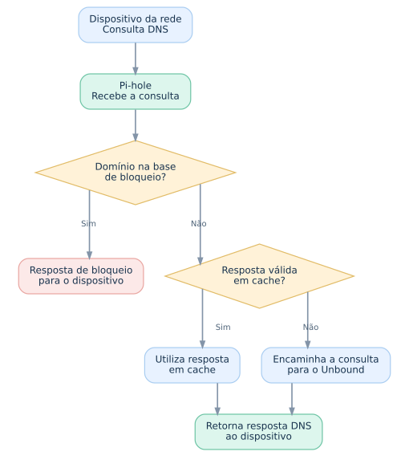
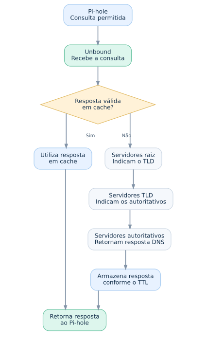

# Rede e DNS

## Arquitetura de rede

Os dois servidores do homelab estão conectados à rede principal por meio de um switch Gigabit Ethernet.

O roteador principal distribui, via DHCP, os endereços dos dois servidores Pi-hole. Cada instância utiliza seu próprio Unbound, permitindo que os dois equipamentos realizem a resolução DNS de maneira independente.

## Pi-hole

O [Pi-hole](https://pi-hole.net/) é uma ferramenta de código aberto que atua como um **DNS sinkhole**, permitindo bloquear a resolução de domínios associados a anúncios, rastreadores, malware e outros conteúdos indesejados na rede.

A filtragem utiliza **blocklists**: listas de domínios que são incorporadas à base local de bloqueio. Um exemplo de fonte é o repositório [HaGeZi DNS Blocklists](https://github.com/hagezi/dns-blocklists). O Pi-hole não precisa consultar essas listas na internet a cada requisição DNS.

### Funcionamento

Quando um dispositivo faz uma consulta DNS, o Pi-hole aplica suas regras de filtragem. Se o domínio estiver bloqueado, retorna uma resposta de bloqueio. Caso seja permitido, pode responder com dados válidos em cache; caso contrário, encaminha a consulta ao resolvedor configurado — neste homelab, o Unbound.

### Limitações

A filtragem DNS atua sobre nomes de domínio, não sobre elementos específicos de uma página. Por isso, anúncios servidos pelo mesmo domínio do conteúdo legítimo podem não ser bloqueados sem afetar também esse conteúdo.

## Unbound

O [Unbound](https://nlnetlabs.nl/projects/unbound/about/) é um resolvedor DNS recursivo de código aberto desenvolvido pela NLnet Labs.

Quando configurado para resolução recursiva, consulta a hierarquia DNS diretamente, sem encaminhar todas as consultas a um resolvedor público único. Isso oferece maior controle sobre a resolução de nomes e reduz a concentração das consultas em um provedor externo.

### Funcionamento

Quando recebe uma consulta do Pi-hole, o Unbound verifica se há uma resposta válida em seu cache. Se não houver, pode iniciar uma resolução recursiva: consulta servidores raiz, servidores do domínio de topo (TLD) e servidores autoritativos, conforme necessário, até obter a resposta.

Respostas podem ser armazenadas em cache de acordo com o TTL, evitando repetir consultas enquanto permanecerem válidas.

### Desempenho, privacidade e segurança

O Unbound utiliza **cache DNS** para armazenar temporariamente respostas de consultas, respeitando seus respectivos TTLs (*Time To Live*). Isso reduz a necessidade de repetir consultas recursivas e pode diminuir a latência de resolução de domínios frequentemente acessados.

Além do cache, o Unbound oferece mecanismos como **validação DNSSEC**, **QNAME minimisation** e suporte a **DNS-over-TLS (DoT)**. A disponibilidade e a ativação desses recursos dependem da versão do software e da configuração adotada, considerando os requisitos de privacidade, segurança e desempenho de cada ambiente. Não se afirma aqui que todos estejam habilitados neste homelab.

Esses mecanismos possuem finalidades distintas:

- **DNSSEC:** permite validar a autenticidade e integridade das respostas DNS provenientes de zonas assinadas, ajudando a prevenir ataques de falsificação de respostas.
- **QNAME minimisation:** reduz a quantidade de informações sobre o domínio solicitado que são enviadas aos diferentes servidores durante a resolução recursiva. Em vez de revelar o nome completo a cada etapa, o resolvedor consulta apenas as informações necessárias naquele estágio.
- **DNS-over-TLS (DoT):** permite criptografar a comunicação DNS entre componentes compatíveis, protegendo o conteúdo das consultas naquele trecho da conexão. Seu uso não significa que toda a resolução recursiva esteja criptografada.

A resolução recursiva local reduz a dependência de resolvedores DNS públicos, mas **não garante anonimato nem criptografia de ponta a ponta**. Na resolução DNS tradicional, determinadas informações ainda podem ser observadas pelos servidores consultados e por intermediários da rede.

### Integração com Pi-hole

Cada servidor físico executa sua própria instância de Pi-hole e Unbound. O Pi-hole filtra as consultas; o Unbound resolve as consultas permitidas quando necessário.

Essa configuração mantém os dois caminhos de resolução independentes entre os servidores e contribui para a redundância DNS da rede principal.

## Redundância DNS

O roteador principal permite configurar múltiplos servidores DNS para distribuição aos dispositivos da rede via DHCP.

Essa funcionalidade foi utilizada para fornecer os endereços das duas instâncias de Pi-hole, cada uma executada em um servidor físico diferente e integrada ao seu próprio Unbound.

A arquitetura reduz a dependência de um único servidor para resolução de nomes.

### Testes de disponibilidade

Foram realizados testes de indisponibilidade para verificar a continuidade da resolução DNS na rede principal.

| Cenário testado | Resultado |
|---|---|
| Ambos os servidores DNS ativos | Resolução DNS funcionando |
| Pi-hole do desktop indisponível | Resolução mantida pelo notebook |
| Pi-hole do notebook indisponível | Resolução mantida pelo desktop |

Os testes demonstraram que a rede principal consegue continuar resolvendo nomes quando uma das instâncias fica indisponível, nas condições avaliadas.

### Limitações da redundância

O comportamento de seleção e alternância entre servidores DNS depende do sistema operacional e da configuração de cada cliente.

Alguns dispositivos podem utilizar os servidores alternadamente, enquanto outros podem recorrer ao servidor alternativo apenas após uma falha ou timeout.

Portanto, a solução oferece **redundância DNS**, mas não garante alta disponibilidade irrestrita para todos os dispositivos da rede.
