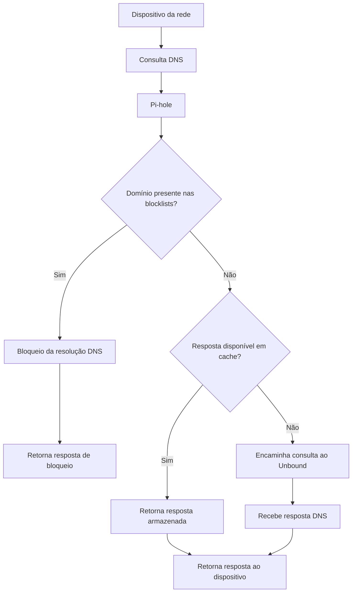
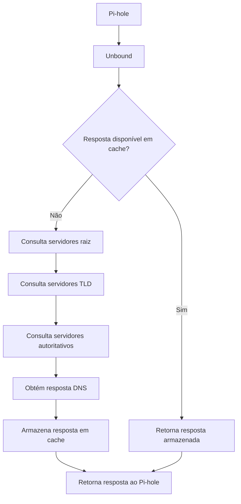

## Arquitetura de rede


Os dois servidores estão conectados à rede principal através de um switch Gigabit Ethernet.

O roteador principal distribui os endereços dos dois servidores Pi-hole via DHCP.

Cada Pi-hole possui sua própria instância do Unbound, permitindo resolução DNS independente entre as duas máquinas.

A redundância DNS foi testada na rede principal.


## Pi-hole

O [Pi-hole](https://pi-hole.net/) é uma ferramenta de código aberto que atua como um **DNS sinkhole**, permitindo bloquear domínios associados a anúncios, rastreadores, malware e outros conteúdos indesejados diretamente na rede.

O bloqueio é realizado por meio de **blocklists**, listas contendo domínios que devem ter sua resolução DNS bloqueada. Essas listas podem ser obtidas de diferentes fontes, como o repositório [Hagezi DNS Blocklists](https://github.com/hagezi/dns-blocklists).

O Pi-hole utiliza essas listas para construir sua base local de domínios bloqueados, consultada durante o processamento das requisições DNS.

### Funcionamento

Quando um dispositivo realiza uma consulta DNS, o Pi-hole verifica se o domínio solicitado está presente em sua base de bloqueio.

- **Domínio bloqueado:** o Pi-hole responde à consulta de acordo com sua política de bloqueio, impedindo a resolução normal do domínio.
- **Domínio permitido:** o Pi-hole verifica se já possui uma resposta válida em cache. Caso não tenha, encaminha a consulta ao resolvedor DNS configurado, que no homelab é o Unbound.

Após receber uma resposta do resolvedor, o Pi-hole a encaminha ao dispositivo solicitante.

### Fluxo de resolução DNS



### Limitações

O bloqueio por DNS atua sobre domínios, não sobre elementos individuais de páginas web.

Por esse motivo, anúncios e rastreadores hospedados no mesmo domínio do conteúdo desejado podem não ser bloqueados sem também afetar o acesso ao conteúdo legítimo.


## Unbound

O [Unbound](https://nlnetlabs.nl/projects/unbound/about/) é um resolvedor DNS recursivo de código aberto, desenvolvido pela NLnet Labs.

Diferentemente de um resolvedor que apenas encaminha consultas para serviços públicos, como Google DNS ou Cloudflare, o Unbound pode realizar a resolução recursiva diretamente, consultando os servidores responsáveis por cada nível da hierarquia DNS.

Essa abordagem reduz a dependência de resolvedores DNS de terceiros, permitindo maior controle sobre a resolução de nomes e evitando concentrar todas as consultas em um único provedor externo.

### Funcionamento

Quando o Pi-hole recebe uma consulta para um domínio permitido e não possui uma resposta válida em cache, ele a encaminha ao Unbound.

O Unbound verifica seu próprio cache e, caso não encontre uma resposta válida, inicia a resolução recursiva.

Por exemplo, para resolver `www.example.com`:

1. **Servidores raiz (Root DNS):** indicam quais servidores são responsáveis pelo domínio de topo `.com`.
2. **Servidores TLD:** indicam quais servidores são autoritativos para `example.com`.
3. **Servidores autoritativos:** fornecem a resposta DNS correspondente ao nome consultado, quando disponível.
4. **Cache:** o Unbound armazena a resposta conforme seu TTL, permitindo atender consultas futuras sem repetir todo o processo.

Após a resolução, o Unbound retorna a resposta ao Pi-hole, que a encaminha ao dispositivo solicitante.

### Fluxo de resolução DNS



### Privacidade e segurança

O Unbound oferece recursos que contribuem para a privacidade e segurança das consultas DNS:

- **Resolução recursiva local:** reduz a dependência de provedores DNS públicos e evita concentrar todas as consultas em um único resolvedor externo.
- **Cache DNS:** armazena respostas temporariamente, reduzindo consultas repetidas e podendo diminuir a latência de resolução.
- **DNSSEC:** permite validar assinaturas criptográficas de registros DNS em zonas que utilizam DNSSEC, ajudando a verificar a autenticidade e integridade das respostas.
- **QNAME minimisation:** reduz a quantidade de informações sobre o domínio solicitado que são enviadas aos servidores DNS durante a resolução recursiva.
- **DNS-over-TLS (DoT):** permite utilizar conexões DNS criptografadas em configurações compatíveis.

É importante observar que a resolução recursiva tradicional não garante criptografia de ponta a ponta nem anonimato completo. Os servidores consultados e outros participantes da rede ainda podem observar determinadas informações.

### Integração com Pi-hole

No homelab, cada servidor físico executa sua própria instância de Pi-hole e Unbound.

O Pi-hole é responsável pela filtragem dos domínios, enquanto o Unbound realiza a resolução DNS das consultas permitidas que não foram respondidas pelo cache.

Essa separação permite manter os serviços DNS independentes entre os dois equipamentos, contribuindo para a redundância da rede principal.
```
