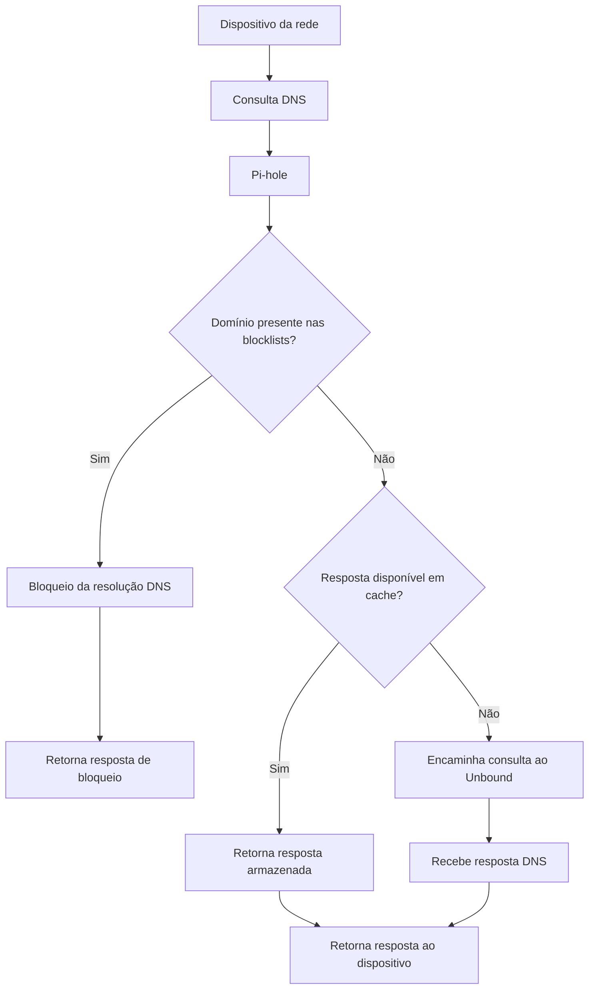

## Arquitetura de rede

Os dois servidores estão conectados à rede principal através de um switch Gigabit Ethernet.

O roteador principal distribui os endereços dos dois servidores Pi-hole via DHCP.

Cada Pi-hole possui sua própria instância do Unbound, permitindo resolução DNS independente entre as duas máquinas.

A redundância DNS foi testada na rede principal.

## Pi-hole

O [Pi-hole](https://pi-hole.net/) é uma ferramenta de código aberto que atua como um **DNS sinkhole**, permitindo bloquear domínios associados a anúncios, rastreadores, malware e outros conteúdos indesejados diretamente na rede.

O bloqueio é realizado por meio de **blocklists**, listas contendo domínios que devem ter sua resolução DNS bloqueada. Essas listas podem ser obtidas de diferentes fontes, como o repositório [Hagezi DNS Blocklists](https://github.com/hagezi/dns-blocklists).

O Pi-hole utiliza essas listas para construir sua base local de domínios bloqueados, consultada durante o processamento das requisições DNS.

### Funcionamento

Quando um dispositivo realiza uma consulta DNS, o Pi-hole verifica se o domínio solicitado está presente em sua base de bloqueio.

- **Domínio bloqueado:** o Pi-hole responde à consulta de acordo com sua política de bloqueio, impedindo a resolução normal do domínio.
- **Domínio permitido:** o Pi-hole verifica se já possui uma resposta válida em cache. Caso não tenha, encaminha a consulta ao resolvedor DNS configurado, que no homelab é o Unbound.

Após receber uma resposta do resolvedor, o Pi-hole a encaminha ao dispositivo solicitante.

### Fluxo de resolução DNS

### Limitações

O bloqueio por DNS atua sobre domínios, não sobre elementos individuais de páginas web.

Por esse motivo, anúncios e rastreadores hospedados no mesmo domínio do conteúdo desejado podem não ser bloqueados sem também afetar o acesso ao conteúdo legítimo.
