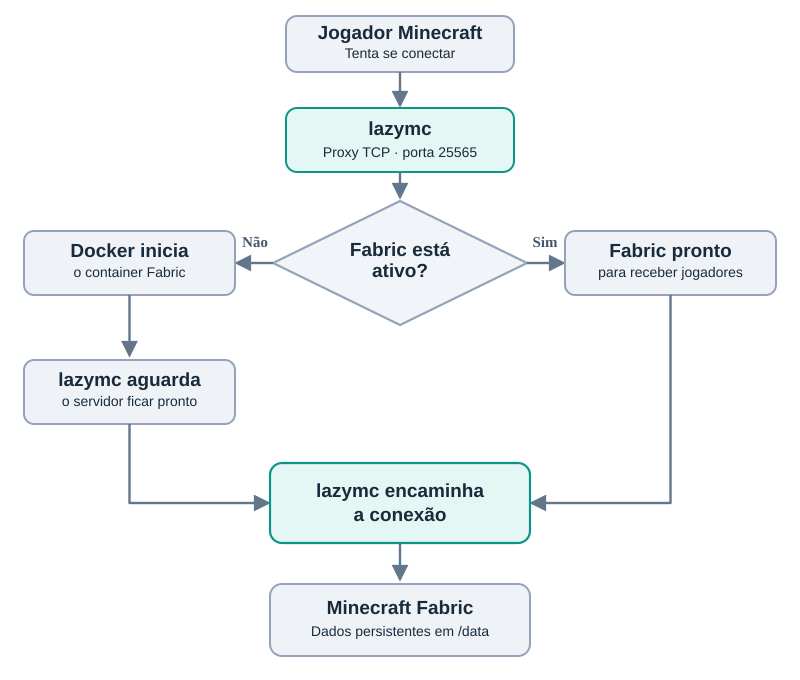

# Serviços hospedados

## Visão geral

O homelab hospeda diferentes serviços utilizados no cotidiano, incluindo compartilhamento de arquivos, reprodução de mídia e um servidor Minecraft de uso familiar.

Os serviços estão distribuídos entre dois servidores Linux:

| Servidor | Serviço | Implantação |
|---|---|---|
| Desktop — Ubuntu Desktop | Samba | Nativa |
| Desktop — Ubuntu Desktop | Jellyfin | Nativa |
| Desktop — Ubuntu Desktop | Pi-hole + Unbound | Nativa |
| Notebook — Ubuntu Server | Pi-hole + Unbound | Nativa |
| Notebook — Ubuntu Server | Minecraft Fabric | Docker Compose |
| Notebook — Ubuntu Server | lazymc | Docker Compose |

A infraestrutura combina serviços instalados diretamente no sistema operacional e aplicações containerizadas, conforme as necessidades de cada ambiente.

Os serviços DNS estão documentados separadamente em [Rede e DNS](network.md).

## Samba

O [Samba](https://www.samba.org/) é uma implementação de código aberto do protocolo SMB, utilizado para compartilhamento de arquivos e outros recursos em rede.

### Funcionamento

O Samba permite disponibilizar diretórios do servidor para outros dispositivos da rede, utilizando o protocolo SMB.

O acesso aos compartilhamentos pode ser controlado por configurações de permissões, usuários e autenticação.

### Implementação no homelab

O Samba está instalado diretamente no Ubuntu do servidor principal.

Ele é utilizado para disponibilizar arquivos armazenados no desktop aos demais dispositivos da rede doméstica.

O serviço utiliza o armazenamento do servidor principal, que possui um pool ZFS mirror para os dados.

Mais informações sobre o armazenamento estão disponíveis em [Armazenamento ZFS](storage.md).


## Jellyfin

O [Jellyfin](https://jellyfin.org/) é um servidor de mídia de código aberto que permite organizar e reproduzir conteúdos como filmes, séries e músicas, de forma semelhante aos serviços de streaming tradicionais, mas utilizando uma biblioteca de mídia hospedada pelo próprio usuário.

Além desses conteúdos, o Jellyfin também permite organizar fotografias e vídeos pessoais, embora seus recursos para gerenciamento desses tipos de mídia sejam mais limitados em comparação com aplicações especializadas.

### Funcionamento

O Jellyfin utiliza bibliotecas de mídia configuradas pelo administrador para identificar, catalogar e disponibilizar os arquivos armazenados no servidor.

Durante a reprodução, o conteúdo pode ser transmitido diretamente ao dispositivo cliente (*Direct Play*) ou passar por transcodificação quando o formato original não é compatível com o cliente.

### Implementação no homelab

O Jellyfin está instalado diretamente no Ubuntu do servidor principal.

Sua principal finalidade é disponibilizar uma biblioteca pessoal de CDs e DVDs digitalizados, preservando o conteúdo das mídias físicas contra possíveis problemas de degradação, como *disc rot*, cujos sinais já eram observáveis em alguns discos do acervo.

Os arquivos são armazenados no pool ZFS mirror do servidor, permitindo o acesso à biblioteca pela rede doméstica.

### Organização da biblioteca

O acervo digitalizado é armazenado em dois diretórios principais, separados conforme a origem dos arquivos: CDs e DVDs.

Para disponibilizar esse conteúdo ao Jellyfin, foi criado um terceiro diretório, denominado `jellyfin`, organizado em três categorias: `movies`, `shows` e `music`.

A integração entre os diretórios originais e a biblioteca é realizada por meio de **links simbólicos (symlinks)**, permitindo que o Jellyfin acesse os arquivos sem a necessidade de duplicá-los.

A estrutura pode ser representada da seguinte forma:

```text
armazenamento/
├── cds/
│   └── album-exemplo/
│
├── dvds/
│   ├── filme-exemplo/
│   └── desenho-exemplo/
│
└── jellyfin/
    ├── movies/
    │   └── filme-exemplo -> ../../dvds/filme-exemplo
    │
    ├── shows/
    │   └── desenho-exemplo -> ../../dvds/desenho-exemplo
    │
    └── music/
        └── album-exemplo -> ../../cds/album-exemplo
```

*Nota: os nomes dos arquivos e diretórios são ilustrativos.*

Essa organização apresenta algumas vantagens:

- **Economia de armazenamento:** evita a duplicação dos arquivos digitalizados.
- **Separação de responsabilidades:** mantém os arquivos originais organizados independentemente da estrutura utilizada pelo Jellyfin.
- **Flexibilidade:** permite reorganizar a biblioteca de mídia sem mover os arquivos originais.
- **Manutenção:** facilita a identificação dos arquivos de origem e a administração da biblioteca.


## Minecraft Fabric

O [Fabric](https://fabricmc.net/) é um ecossistema de ferramentas para Minecraft que permite executar modificações no jogo por meio de mods compatíveis.

### Implementação no homelab

O servidor Minecraft é hospedado no notebook com Ubuntu Server, utilizando Docker Compose.

A implantação utiliza a imagem `itzg/minecraft-server`.

O container possui um diretório persistente no host, montado em `/data`, para armazenar os arquivos do servidor e do mundo.

O ambiente foi configurado para utilização familiar na rede doméstica.

## lazymc

O [lazymc](https://github.com/timvisee/lazymc) é uma ferramenta utilizada para iniciar servidores Minecraft sob demanda, evitando manter o processo do jogo ativo quando não há jogadores conectados.

### Funcionamento

O lazymc atua como um proxy que recebe tentativas de conexão na porta padrão do Minecraft.

Quando um jogador tenta se conectar e o servidor Fabric está inativo, o lazymc aciona sua inicialização por meio da integração com o Docker.

Após a inicialização do container, as conexões passam a ser encaminhadas ao servidor Minecraft.

Essa abordagem permite reduzir o consumo de recursos durante os períodos de inatividade.



### Implementação no homelab

No notebook, o lazymc e o Minecraft Fabric são executados em containers definidos no mesmo arquivo Docker Compose.

Foi configurada uma rede Docker bridge personalizada para permitir a comunicação entre os serviços.

O lazymc recebe as conexões pela porta TCP 25565 e utiliza a integração com o Docker para controlar a inicialização do container Minecraft.

O uso de bind mounts permite armazenar os arquivos do Minecraft diretamente no sistema de arquivos do notebook, preservando-os independentemente da criação ou remoção dos containers.

## Automação e persistência

Os arquivos do Minecraft são armazenados fora do sistema de arquivos temporário do container, por meio de um bind mount.

Além disso, uma rotina agendada com cron utiliza rsync sobre SSH para transferir os dados do notebook ao desktop principal.

A configuração e as limitações dessa rotina estão documentadas em [Backups](backups.md).

## Considerações de segurança

Os serviços foram implantados para atender às necessidades da rede doméstica.

Os serviços do homelab são destinados ao uso na rede doméstica, sem exposição pública intencional à internet. Essa restrição reduz a superfície de exposição externa, mas não elimina a necessidade de controlar permissões, atualizar os serviços e revisar as configurações de segurança.

O ambiente utiliza uma combinação de serviços nativos e containers Docker. A administração e a segurança de cada serviço dependem de suas configurações, permissões e mecanismos de acesso.

## Possíveis melhorias

- Implementar monitoramento de disponibilidade dos serviços.
- Centralizar a visualização de logs e eventos.
- Documentar procedimentos de atualização e recuperação.
- Revisar periodicamente as configurações de segurança e permissões.

